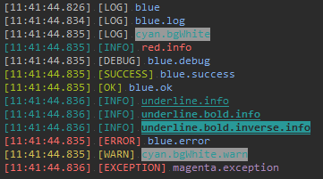
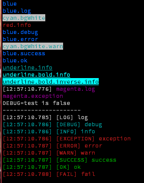

# debug-color2

彩色化 console.log 輸出，可自定義樣式、時間戳記和標籤。與 [debug](https://www.npmjs.com/package/debug) 模組相容，支援 RGB、HSL、HEX 和關鍵字顏色。

Colorize console.log output with customizable styles, timestamps, and labels. Works with the debug module and supports RGB, HSL, HEX, and keyword colors.



## 功能特點 / Features

- ✅ 與原生 Console API 相容 (Same API as native console)
- ✅ 與 debug 模組整合 (Works with debug module)
- ✅ 支援多種顏色格式：RGB、HSL、HEX、關鍵字 (Multiple color formats)
- ✅ 自定義時間戳記格式 (Customizable timestamp format)
- ✅ 自定義標籤顯示 (Customizable label display)
- ✅ 鏈式語法風格 (Chainable style syntax)
- ✅ TypeScript 類型支援 (TypeScript support)

## 安裝 / Installation

```bash
# 使用 npm
npm install debug-color2

# 使用 yarn
yarn add debug-color2

# 使用 pnpm
pnpm add debug-color2
```

## 快速開始 / Quick Start

```typescript
import { Console } from 'debug-color2';

// 建立帶顏色的 Console 實例
// Create a colorized console instance
const c1 = new Console();

// 使用預設 console
// Use default console
const c2 = new Console(console);

// 自定義選項
// With custom options
const c3 = new Console(console, {
    time: true,
    label: true,
});
```

## API

### 選項 / Options

完整配置選項說明請參考 [IOptions 配置選項](docs/ioptions.md)。

```typescript
export interface IOptions
{
    /**
     * 啟用或停用日誌顯示
     * Enable or disable log display
     */
    enabled?: boolean,

    /**
     * 顯示標籤字串
     * Show label string
     */
    label?: boolean | string[],

    /**
     * 顯示時間戳記
     * Show time label
     */
    time?: boolean,

    /**
     * 允許自定義時間格式
     * Allow custom time format
     * @default '[HH:mm:ss.SSS]'
     */
    timeFormat?: string;

    /**
     * 允許自定義標籤格式
     * Allow custom label format
     */
    timeFormatFn?<T extends unknown[]>(data: {
        failBackTimeFormat: string
        date: DateTime,
    }): string;

    /**
     * 設定預設的 inspectOptions
     * Set default inspectOptions
     */
    inspectOptions?: util.InspectOptions,

    /**
     * 設定顏色樣式
     * Set color styles
     */
    colors?: {
        debug?,
        error?,
        info?,
        log?,
        trace?,
        warn?,
        success?,
        ok?,
        [k: string]: string | Chalk | IChalkLike,
    },

    /**
     * 檢查是否為 Node.js console
     * Check if is node.js console
     */
    readonly stream?: boolean,
}
```

### 顏色方法 / Color Methods

```typescript
let c1 = new Console();

// 基本顏色 / Basic colors
c1.blue('blue');
c1.red('red');
c1.cyan('cyan');
c1.green('green');

// 背景顏色 / Background colors
c1.cyan.bgWhite('cyan.bgWhite');

// 組合使用 / Combined
c1.underline.info('underline.info');
c1.underline.bold.info('underline.bold.info');
c1.underline.bold.inverse.info('underline.bold.inverse.info');

// 訊息類型 / Message types
c1.blue.log('blue.log');
c1.red.info('red.info');
c1.blue.debug('blue.debug');
c1.blue.error('blue.error');
c1.cyan.bgWhite.warn('cyan.bgWhite.warn');

// 額外方法 / Extra methods
c1.blue.success('blue.success');
c1.blue.ok('blue.ok');
c1.magenta.exception('magenta.exception');
```

### 時間戳記與標籤 / Timestamps and Labels

```typescript
// 使用自定義選項 / Using custom options
c1.magenta.withOptions({
    time: true,
}).log('magenta.log');

// 動態設定選項 / Dynamic options
c1.setOptions({
    label: true,
    time: true,
});

c1.log('log');
c1.assert(true, 'assert');

c1.debug('debug');
c1.info('info');

c1.exception('exception');
c1.error('error');
c1.warn('warn');

c1.success('success');
c1.ok('ok');
c1.fail('fail');
```

### 與 debug 模組整合 / Integration with debug module

```typescript
import debug from 'debug';

// 根據 debug 環境變數控制輸出
// Control output based on DEBUG environment variable
let c2 = c1.magenta.withOptions({
    enabled: debug('test').enabled
});

console.log('DEBUG=test is', debug('test').enabled);

c2.log('this show when DEBUG=test or DEBUG=*');
```

## 預設匯出 / Default Export

```typescript
import ConsoleColorize from 'debug-color2';

// 使用預設實例
// Use default instance
ConsoleColorize.console.log('Hello World!');
```

## 顏色支援 / Color Support

詳細的顏色配置和樣式方法說明請參考 [IOptions 配置選項](docs/ioptions.md)。

- **基本顏色**: black, red, green, yellow, blue, magenta, cyan, white, gray/grey
- **亮色**: blackBright, redBright, greenBright, yellowBright, blueBright, magentaBright, cyanBright, whiteBright
- **背景色**: bgBlack, bgRed, bgGreen, bgYellow, bgBlue, bgMagenta, bgCyan, bgWhite
- **亮背景**: bgBlackBright, bgRedBright, bgGreenBright, bgYellowBright, bgBlueBright, bgMagentaBright, bgCyanBright, bgWhiteBright
- **樣式**: bold, dim, italic, underline, inverse, hidden, strikethrough
- **自定義顏色**: rgb(), hsl(), hsv(), hwb(), hex(), keyword()

如需了解所有樣式方法（如 `rgb`, `hex`, `hsl` 等），請參考 [Implementation](docs/implementation.md)。

## TypeScript 類型 / TypeScript Types

完整的 TypeScript 類型定義可在 [lib/node.d.ts](lib/node.d.ts) 查看。

Full TypeScript type definitions available at [lib/node.d.ts](lib/node.d.ts).

## 文件 / Documentation

更多詳細文件請參考 [docs/](docs/) 目錄：

- [模組總覽 / Modules Overview](docs/README.md) - 所有模組的分類說明
- [實作細節 / Implementation](docs/implementation.md) - 鏈式呼叫與核心邏輯
- [日誌模組 / Logger Module](docs/logger.md) - 預設日誌實例說明
- [內部屬性與方法 / Internal Properties](docs/console2-internal.md) - Console2 內部符號與存取器
- [配置選項 / Configuration Options](docs/ioptions.md) - IOptions 完整說明

For more detailed documentation, see the [docs/](docs/) directory:

- [Modules Overview](docs/README.md) - Categorized module documentation
- [Implementation Details](docs/implementation.md) - Chainable calling and core logic
- [Logger Module](docs/logger.md) - Pre-configured logger instance
- [Internal Properties and Methods](docs/console2-internal.md) - Console2 internal symbols and accessors
- [Configuration Options](docs/ioptions.md) - Complete IOptions documentation

## 範例圖片 / Demo



